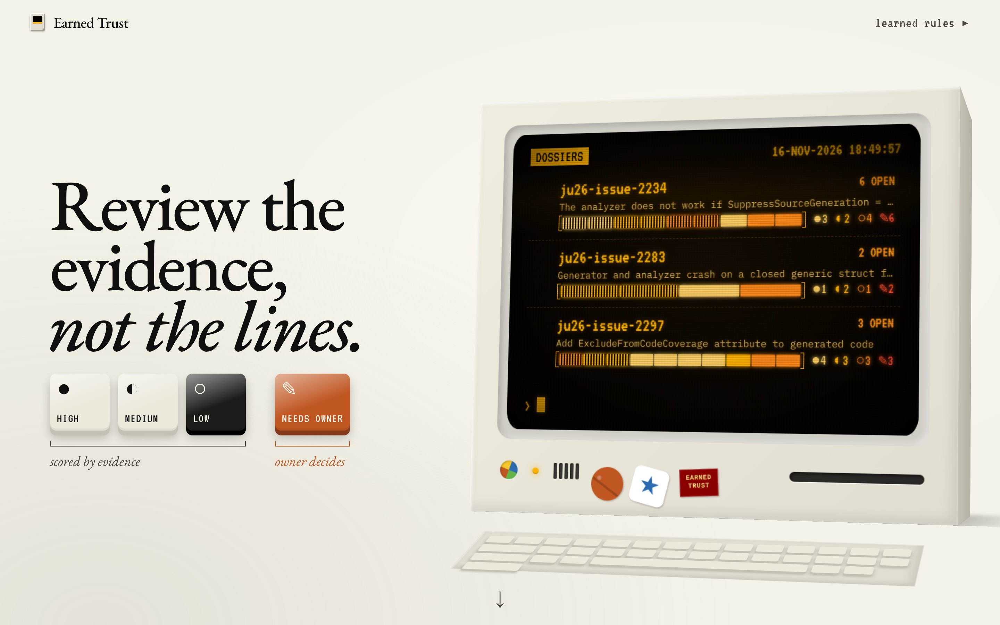
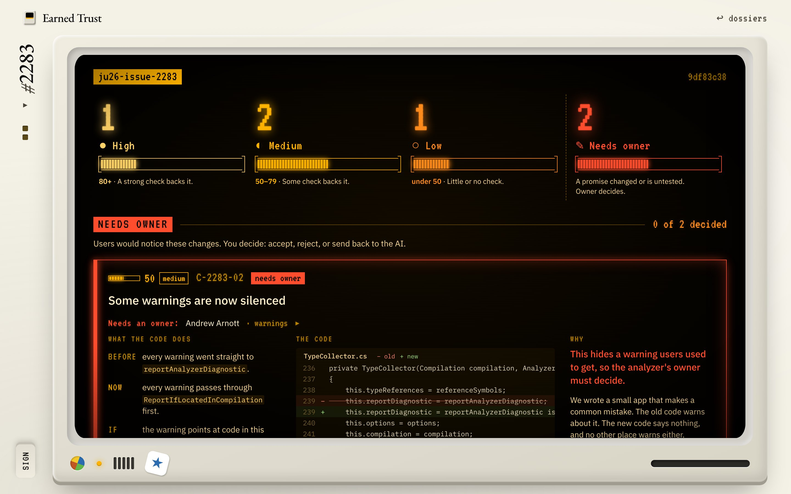
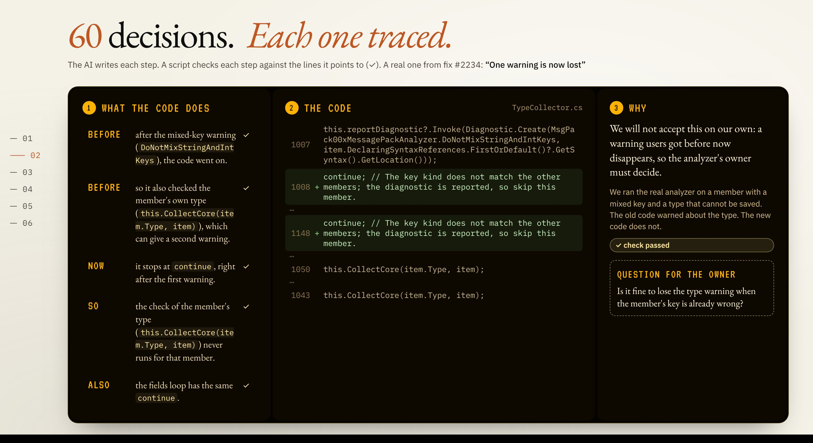
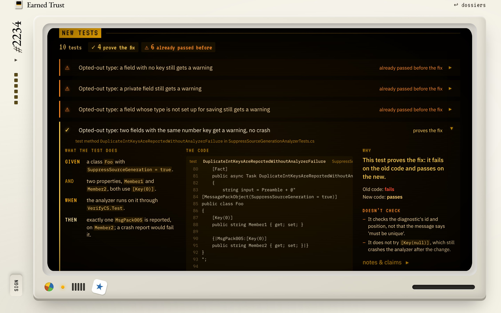
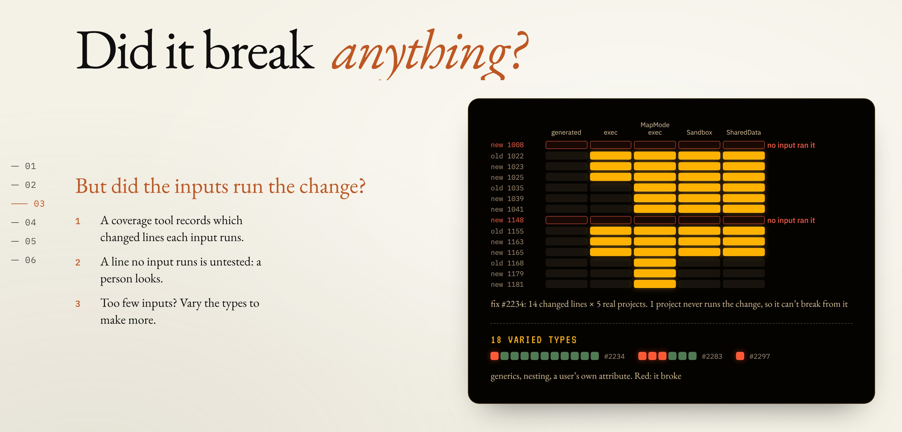
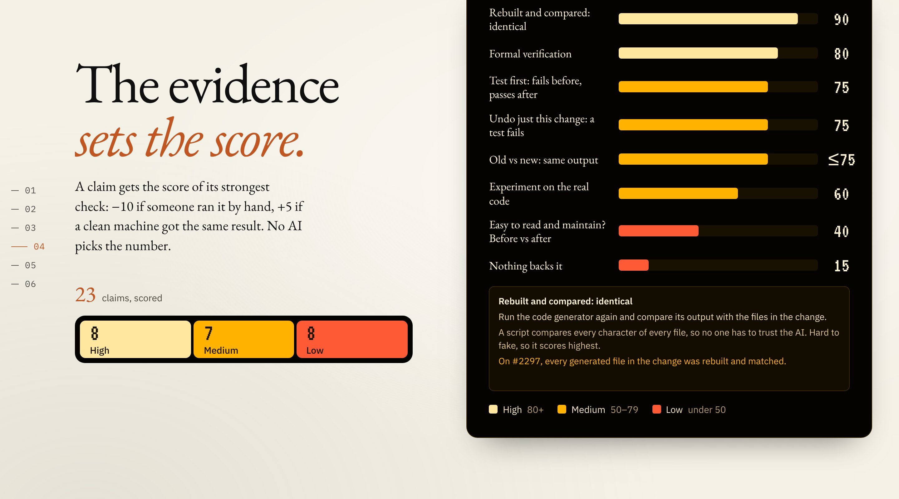
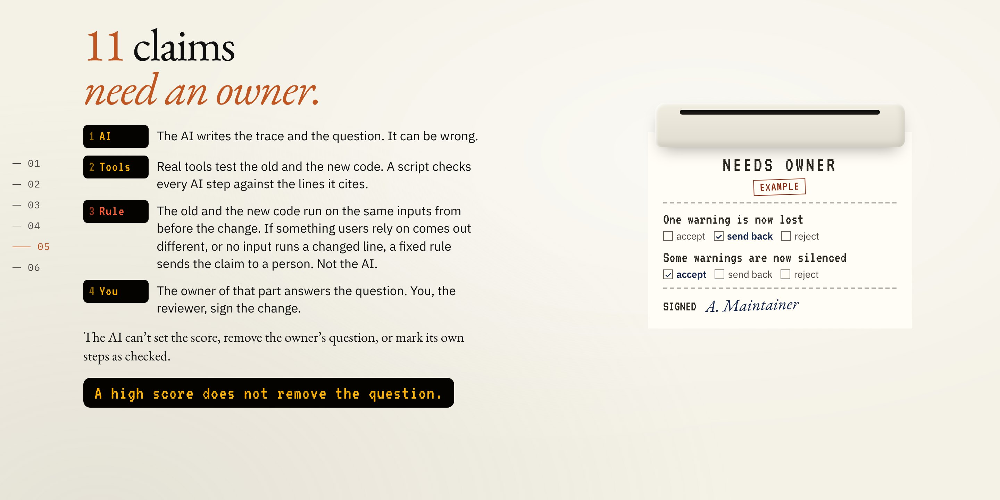
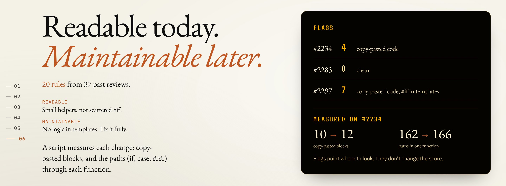
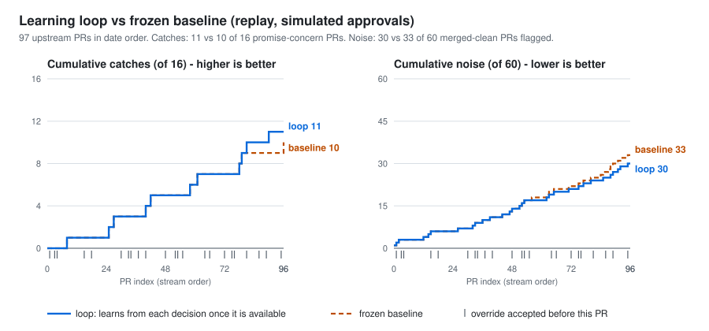
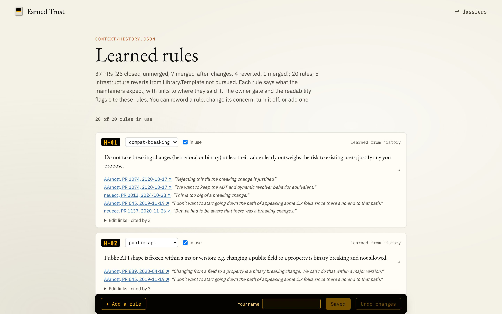

<h1 align="center">Earned Trust</h1>

<p align="center"><b>Review the evidence, not the lines.</b><br>
A code reviewer for changes written by AI agents.</p>

<p align="center">
  <a href="LICENSE"></a>
  
  
</p>

<p align="center"></p>

AI agents now write changes faster than people can read them. A typical fix is hundreds of lines with dozens of small decisions inside. "An AI reviewer said it's fine" is not a reason to merge.

Earned Trust turns each change into short **claims**, and backs every claim with a **real check**: a test, a rebuild, a proof, or a run of the old and new code side by side. A fixed formula turns the evidence into a **confidence score** from 0 to 100. When a change touches something users rely on, the AI does not decide: the claim **needs an owner**, and a named maintainer signs a receipt.

Built at Junction 2026 for Tieto's *Earned Trust in AI Code* challenge, where it placed **3rd**.

## What you get

For every AI-made branch, a **dossier**: the claims, the score of each one, the evidence behind it, and the questions only a person can answer.

<p align="center"></p>

<table>
<tr>
<td width="50%"></td>
<td width="50%"></td>
</tr>
<tr>
<td><b>Every decision, traced.</b> The AI explains each step in plain words next to the lines it points to. A script checks that each step matches the code.</td>
<td><b>Tests that prove the fix.</b> A new test only counts if it fails on the old code and passes on the new. On #2234, 4 of 10 new tests did.</td>
</tr>
<tr>
<td></td>
<td></td>
</tr>
<tr>
<td><b>Did it break anything?</b> Old and new code run on the same inputs. Coverage shows which changed lines the inputs reached. A line no input runs is untested.</td>
<td><b>The evidence sets the score.</b> A claim gets the points of its strongest check. No AI picks the number.</td>
</tr>
<tr>
<td></td>
<td></td>
</tr>
<tr>
<td><b>Some decisions belong to a person.</b> A high score never removes the owner's question.</td>
<td><b>Readable today, maintainable later.</b> 20 rules learned from 37 past pull requests. Flags point where to look; they do not change the score.</td>
</tr>
</table>

## How the score works

Each claim gets the points of its strongest check. The formula is in [`review/CONVENTIONS.md`](review/CONVENTIONS.md).

| Evidence | Points | Also known as |
|---|---:|---|
| Rebuild the generated code and compare: identical | 90 | equivalence checking, reproducible builds |
| Model proved, and matched to the real code on every tested input | 80 | formal verification (Dafny), model-based testing |
| A test fails before the change and passes after | 75 | fail-to-pass test |
| Undo only this change: a test fails | 75 | mutation testing |
| Old vs new code on the same inputs: no unexplained difference | 30–75 | differential testing with diff coverage |
| Count of copy-pasted blocks or paths | 40 | static code metrics |
| Nothing backs it | 15 | — |

Old vs new scores `30 + 45 × (changed lines reached ÷ trackable changed lines)`, so a run that never touches the change earns little.

Adjustments: run by hand −10 · an undo test also backs it +5 · a clean-machine re-run matched +5, did not match −30 · contradicting evidence caps the score at 25.

**Bands:** high ≥ 80 · medium 50–79 · low < 50.

**Needs owner** is separate from the score. A claim goes to a person when the old and new code give a different result on something users rely on, or when no input runs a changed line. The owner is the top committer on those paths. They accept, reject, or send the change back to the AI.

**Tripwires** (like contract testing for API contracts) mark which changed code is tied to a public promise. There are 7 contracts: diagnostics, public API, generated files, targets, wire format, security and user docs. Each one lists paths and line patterns. [`tripwires.py`](review/scripts/tripwires.py) checks every changed hunk against them and finds the claims that cover it. A tripped hunk must be covered by a claim. If no input runs a changed line in a tripped hunk, the claim needs an owner. Trips on the three branches: #2297 31 (out of 423 hunks), #2234 7, #2283 7. Every trip is covered by a claim. A trip does not mean the change is wrong. It means someone who knows that promise should look.

## Results

Three AI-made fixes on [`junction26-messagepack-csharp`](https://github.com/te-industry-tech-office/junction26-messagepack-csharp), base `32258fdb`:

| Branch | Claims | High | Medium | Low | Needs owner | New tests that prove the fix |
|---|---:|---:|---:|---:|---:|---:|
| [#2297](review/dossier/ju26-issue-2297.md) coverage attribute on generated code | 10 | 4 | 3 | 3 | 3 | 2 of 2 |
| [#2234](review/dossier/ju26-issue-2234.md) analyzer with `SuppressSourceGeneration` | 9 | 3 | 2 | 4 | 6 | 4 of 10 |
| [#2283](review/dossier/ju26-issue-2283.md) crash on a closed generic struct | 4 | 1 | 2 | 1 | 2 | 3 of 3 |
| **Total** | **23** | **8** | **7** | **8** | **11** | |

On #2234 the Dafny model was checked against the real code on 3,710 inputs with 0 differences, and it found one input where the fix still crashes.

## Learns from maintainer decisions

The owner gate starts from hand-written contracts. The loop changes them from what maintainers actually decide:

1. **Log.** Every decision goes to [`decisions.jsonl`](review/context/decisions.jsonl): owner picks on a receipt, and past upstream PRs (pushed back, reverted, or merged with no objection).
2. **Propose.** A script suggests changes: widen a contract that missed a pushed-back PR, narrow one that keeps flagging clean merges, turn off a rule owners keep overruling, or add a rule that quotes a maintainer.
3. **Gate.** Each change is replayed on earlier PRs. It must fix the case it came from without missing anything it caught before or adding noise. Rule proposals have no ground truth, so they only get a citation check.
4. **Accept.** A person accepts or rejects it on the Rules page. Nothing is applied automatically, and accepted contract changes do not touch the three dossiers.

**Replay.** All 97 PRs in date order: 16 the maintainers pushed back on for a user promise, 60 ordinary merges, and 21 other pushbacks. Each PR is scored before its decision is fed back. Approvals are simulated (every change that passes the gate is accepted).

| | Learning loop | Frozen baseline |
|---|---:|---:|
| Pushed-back PRs caught (of 16) | 11 | 10 |
| Clean merges flagged as noise (of 60) | 30 | 33 |
| Later half: caught (of 9) | 6 | 5 |
| Later half: noise (of 27) | 17 | 20 |

<p align="center"></p>

It beats the baseline, but only just, and on few changes. The loop accepted 23 changes, and only 4 changed a scored result:
- Adding `MessagePackSerializerOptions.cs` to the public API contract caught #1828 and #2013 later.
- Two narrowed analyzer paths removed 2 noisy flags.
- One bad narrowing, accepted before any pushback had been seen, removed 1 noisy flag but lost #2139.

Most widenings only memorise the PR they came from. Guards against blinding a contract's own files score better (12 caught, 27 noise), but we added them after seeing the results, so they are not the headline. They are on in the live proposals list.

**Limits:** small numbers, so one PR moves a rate by about 6 points. Approvals are simulated. The data comes from one upstream repo, and the 2025 contracts were written after these PRs. Full numbers and what we tried are in [`feedback-loop.json`](review/evidence/feedback-loop.json).

```bash
npm run learn
```

Rebuilds the decision log, the proposals and the replay offline from the cached PR stream. To rebuild that cache: `python3 review/scripts/pr_stream.py --repo $MP_REPO --fetch --write --verify`.

## Quick start

Needs Python 3, git and Node.

```bash
git clone https://github.com/YaokaiZhang/code-reviewer-junction.git
```

```bash
cd code-reviewer-junction && npm run dev
```

Opens the owner view at http://localhost:5173/web/. No other setup. Another port: `npm run dev -- --port 3001`.

The learned rules are at http://localhost:5173/web/#/rules. Reword a rule, change its concern, turn it off or add one, then Save. The dev server writes `review/context/history.json`, records your name on each changed rule, and re-scores the dossiers.

<p align="center"></p>

## Reproduce the evidence

| Command | Does | Time |
|---|---|---|
| `npm run setup` | clone the target into `.work/mp`, install .NET SDK 8.0.402 into `.work/dotnet` if missing | 1–2 min |
| `npm run evidence` | git-only collectors: diff classifier, clones and complexity, report sites, claim coverage, source excerpts | seconds |
| `npm run tests` | build and run the C# tests: regeneration, TransformUtilities removal, old-vs-new tests, dropped-warning probe | ~4 min |
| `npm run render` | rebuild the dossiers and `review/web/data.js` | 1 s |
| `npm run sign -- ju26-issue-2283` | sign a dossier from the terminal, writes `review/receipts/` and `decisions.jsonl` | — |
| `npm run learn` | decision log, proposals, replay vs baseline, chart (offline) | seconds |

Use your own clone with `MP_REPO=/path/to/clone npm run evidence`. The Dafny proof (`review/proof/`) needs Dafny and is not part of `npm run tests`. Every evidence file has a `command` field with the exact command that produced it.

### Deploy

The owner view is a static site. To host it on [Modal](https://modal.com):

```bash
pip install modal && modal deploy modal_app.py
```

Saving rules only works with the local dev server.

## Layout

```
review/
  CONVENTIONS.md       schemas, score formula, owner gate, honesty rules
  REQUIREMENTS.md      requirements per issue; inferred lines are marked
  LESSONS.md           what we learned
  DECISIONS.md         design decisions and why
  context/             maintainer history, learned rules, decision log, proposals
  evidence/<branch>/   one JSON per check, each with its command
  explain/<branch>     the AI's step-by-step trace of each decision
  dossier/<branch>.*   claims (.json) and the PR comment (.md)
  source/<branch>.json diff hunks behind each claim, with GitHub links
  proof/               Dafny model and proof for #2234
  receipts/            signed receipts
  scripts/             collectors and renderers (Python 3, standard library)
  web/                 the owner view (static HTML, CSS, JS)
  card/                one-page concept card
docs/screenshots/      images in this README
```

## License

[MIT](LICENSE) © 2026 Yaokai Zhang, Wanqi Wang, Manas Vernekar, and Maksim Lonishin
